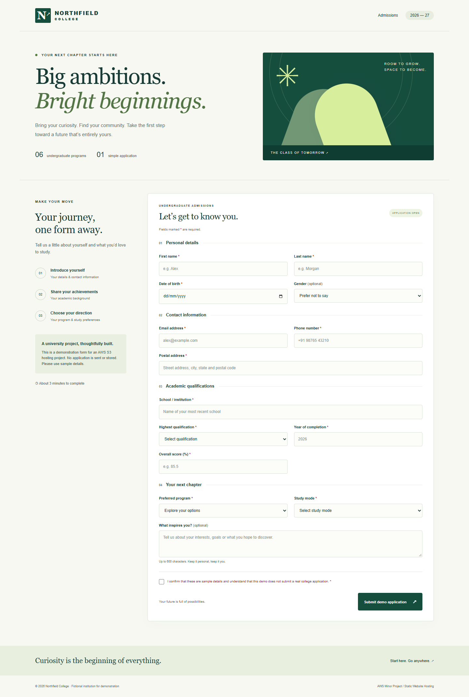
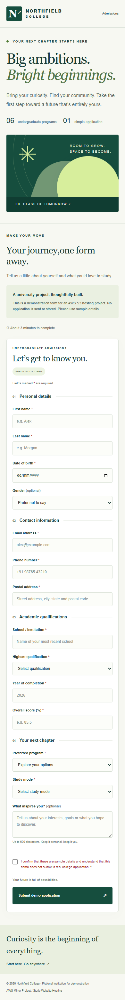
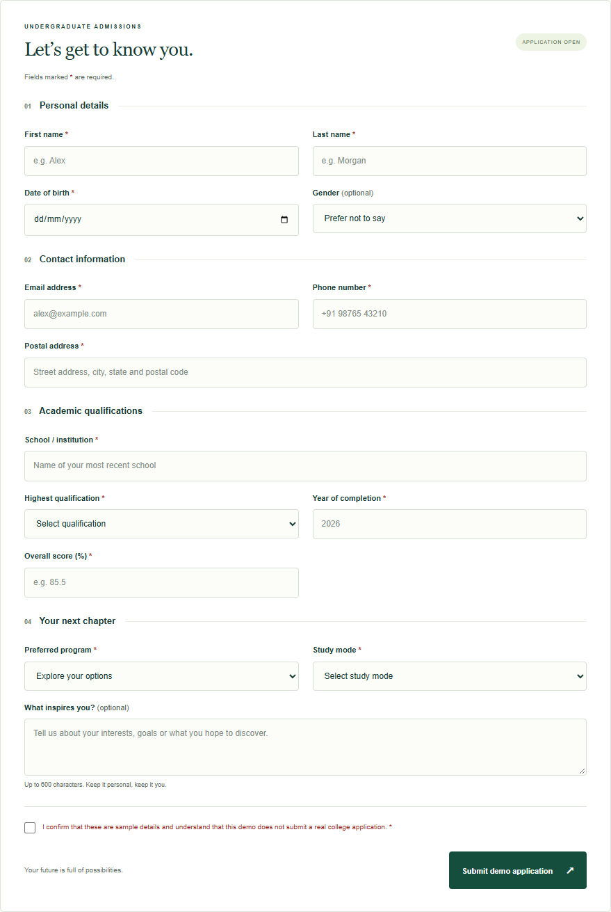
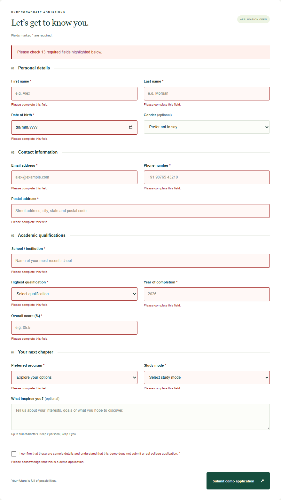
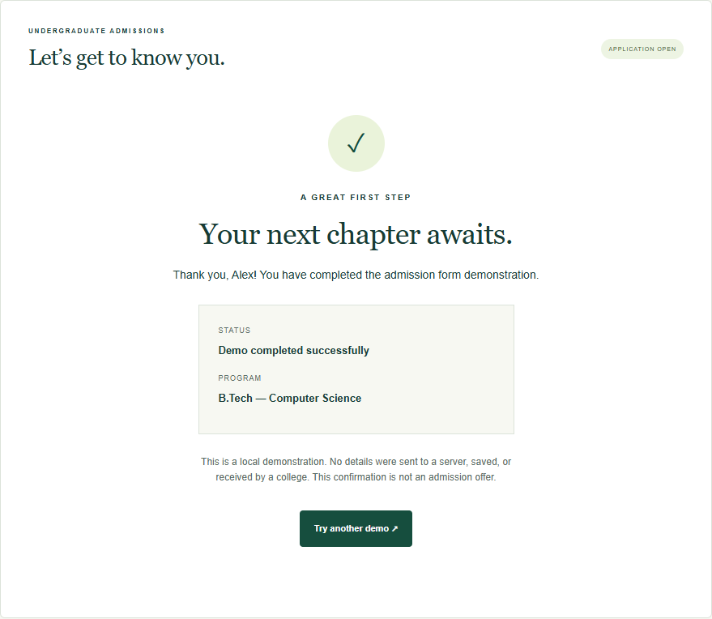

# AWS Minor Project — College Admission Form

A responsive college admission website prepared for the university assignment **AWS S3 Static Website Hosting**. Built by Ahmad Aftab (`ahmadaftabx`) with HTML, CSS and vanilla JavaScript. Northfield College is a fictional institution used for this demonstration.

**[Open the live GitHub Pages demo](https://ahmadaftabx.github.io/aws-college-admission-minor-project/)** · **[Browse the source](https://github.com/ahmadaftabx/aws-college-admission-minor-project)**

## Deployment status

| Deliverable | Status |
| --- | --- |
| Complete responsive website | Complete |
| Genuine desktop, mobile, form, validation and confirmation screenshots | Complete; embedded below |
| Public GitHub source repository | Published on `main` |
| GitHub Pages | Separate demo hosting; see live link above |
| AWS S3 bucket and website deployment | **Incomplete — no AWS credentials were available** |
| AWS deployment evidence | **Not available — no deployment is claimed** |

GitHub Pages is not AWS S3 hosting. The website and documentation are ready, but the professor's AWS requirements are **not fully satisfied until an actual S3 deployment is completed and verified**. The AWS credential provider check returned no profiles, no credentials and no configured region. No bucket was created or modified.

## Features

- Responsive desktop and mobile layout with an original green editorial design and CSS artwork.
- Personal details, date of birth, email, phone and postal address.
- Academic institution, qualification, completion year and percentage.
- Six undergraduate programs, study mode and an optional personal statement.
- Field-level validation and an accessible error summary; keyboard focus and associated labels.
- Rejects missing fields, invalid email/phone, future birth dates, non-integer completion years and percentages outside 0–100.
- Demo consent, personalized confirmation and reset to start again.
- No framework, build step, external fonts, images, analytics or backend required.

**Demo behavior:** submission is handled only in the browser. No information is sent, saved or received by a college. Use fictional sample data. Refreshing clears the form; the confirmation is not an admission offer. A real application service would require a backend, server validation and appropriate data handling.

## Screenshots

All images below are genuine Chrome captures of the locally running website, using fictional sample data. They demonstrate the frontend, not AWS deployment. Desktop viewport: 1440 × 1000. Mobile viewport: 390 × 844. Full-page captures can be taller than the viewport.

### Full desktop website



### Mobile website



### Admission form



### Form validation



### Successful demo submission



## Project structure

```text
aws-college-admission-minor-project/
├── index.html                   # Semantic page and admission form
├── style.css                    # Responsive design and CSS artwork
├── script.js                    # Validation, demo confirmation and reset
├── bucket-policy.json           # Public GetObject policy template
├── website-config.json          # S3 website index configuration
├── public-access-config.json    # Permit public bucket policies; keep ACLs blocked
├── screenshots/                 # Five genuine frontend screenshots
├── tests/browser_checks.py      # Reproducible browser checks and screenshots
├── .gitignore
└── README.md
```

## Run locally

From this directory, run:

```sh
python -m http.server 8000
```

Open `http://localhost:8000`. Alternatively open `index.html` directly. All website assets use relative paths compatible with S3 and GitHub Pages.

## Verification

Automated Chrome checks passed for 13 required inputs, malformed email and phone, a future date of birth, percentage limits, fractional completion years, a valid submission, confirmation visibility, reset, mobile overflow and absence of JavaScript runtime errors.

To reproduce the browser checks, install Python and Playwright (`python -m pip install playwright`), install Chromium (`python -m playwright install chromium`), serve the project on port 8765 and run `python tests/browser_checks.py`. Set `CHROME_PATH` only if using an existing Chrome executable. The script regenerates the five screenshots.

## Complete the AWS S3 deployment

These are deployment instructions, **not a record of executed AWS operations**. An AWS account, configured AWS CLI credentials and permission to create/configure an S3 website bucket are required. Use a dedicated bucket containing only these public website files. AWS usage can incur charges.

The examples below use a Bash-compatible shell. Choose a globally unique bucket name. The policy template's `REPLACE_WITH_YOUR_BUCKET_NAME` must be replaced with that exact name before applying it.

```sh
export AWS_REGION=us-east-1
export BUCKET=your-unique-college-admission-bucket

# Verify which AWS account will be used.
aws sts get-caller-identity

# Create a new dedicated bucket (this example is for us-east-1).
aws s3api create-bucket --bucket "$BUCKET" --region "$AWS_REGION"

# Upload only the three public website assets.
aws s3 cp index.html "s3://$BUCKET/index.html" --content-type 'text/html; charset=utf-8'
aws s3 cp style.css "s3://$BUCKET/style.css" --content-type 'text/css; charset=utf-8'
aws s3 cp script.js "s3://$BUCKET/script.js" --content-type 'text/javascript; charset=utf-8'

# Enable the index document and permit a public read bucket policy.
aws s3api put-bucket-website --bucket "$BUCKET" --website-configuration file://website-config.json
aws s3api put-public-access-block --bucket "$BUCKET" --public-access-block-configuration file://public-access-config.json

# Create the final policy from the template.
sed "s/REPLACE_WITH_YOUR_BUCKET_NAME/$BUCKET/g" bucket-policy.json > /tmp/college-bucket-policy.json
aws s3api put-bucket-policy --bucket "$BUCKET" --policy file:///tmp/college-bucket-policy.json

# Inspect the actual deployment configuration.
aws s3api list-objects-v2 --bucket "$BUCKET"
aws s3api get-bucket-website --bucket "$BUCKET"
aws s3api get-public-access-block --bucket "$BUCKET"
aws s3api get-bucket-policy-status --bucket "$BUCKET"

# This is a template URL until the bucket is deployed and verified.
curl --fail "http://$BUCKET.s3-website-us-east-1.amazonaws.com/"
```

For another region, use its matching S3 website endpoint. Bucket creation outside `us-east-1` also requires `--create-bucket-configuration LocationConstraint=REGION`. Account-level Block Public Access or organizational policies can still prevent a public bucket policy; the most restrictive setting applies. The configuration above leaves public ACLs blocked and grants only `s3:GetObject` through the bucket policy, without write or bucket-list permission. Do not place private data in the website bucket. S3 website endpoints serve HTTP; use a suitable HTTPS frontend for production.

### Evidence still required for the professor

1. Capture the real S3 bucket and uploaded website objects.
2. Capture the bucket public access configuration and actual public read policy.
3. Capture Static website hosting enabled with `index.html` and the real endpoint.
4. Open that S3 website endpoint without authentication; verify HTML, CSS, JavaScript, validation and confirmation.
5. Capture the website with its real S3 URL visible and add those genuine images to this README.

Do not use the local or GitHub Pages screenshots as proof of AWS hosting. The assignment is specifically about an S3 static website, not a working admissions backend. Amazon Lex belongs to the separate major project and is outside this minor project.

## AWS references

- [AWS: Enabling website hosting](https://docs.aws.amazon.com/AmazonS3/latest/userguide/EnableWebsiteHosting.html)
- [AWS: Setting permissions for website access](https://docs.aws.amazon.com/AmazonS3/latest/userguide/WebsiteAccessPermissionsReqd.html)

## Author

Ahmad Aftab · [@ahmadaftabx](https://github.com/ahmadaftabx)
